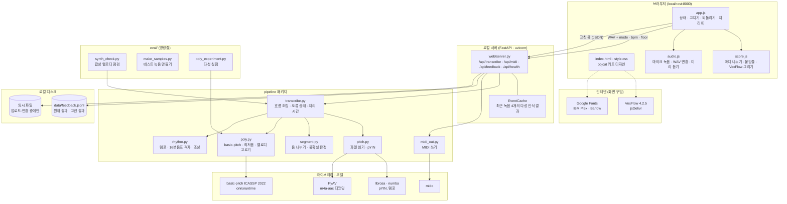
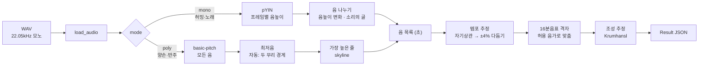

# 아키텍처

로컬 전용(배포 안 함). 한 컴퓨터에서 서버를 켜고 브라우저로 `http://localhost:8000`에 접속한다.

## 1. 전체 구성

## 2. 처리 흐름 (서버 안)

## 3. 설계 결정

| 결정 | 이유 | 대가 |
|---|---|---|
| 로컬 전용, 서버 1개 | 혼자 쓰는 도구, 배포 안 함 (2026-11-27 결정) | 휴대폰 마이크는 HTTPS가 필요해 쓰기 어려움 |
| 브라우저가 WAV로 바꿔 보냄 | 녹음 형식(webm·mp4)이 브라우저마다 달라서, 서버는 WAV만 받으면 되게 | 업로드 크기가 커짐 (1분 약 2.6MB) |
| 동기 처리 | PRD 4장. 1분 녹음이 10~30초 안에 끝남 (측정값) | 처리 중 서버가 그 요청에 묶임. 혼자 쓰니 괜찮음 |
| 서버 시작 때 미리 한 번 돌림 | numba 컴파일·ONNX 불러오기로 첫 요청이 몇 초 느려짐 | 서버가 켜지는 데 몇 초 걸림 |
| 다성 인식 결과 캐시 | 템포·최저음만 바꿀 때 25초 인식을 다시 하지 않으려고 | 메모리에 녹음 4개 분량 보관 |
| 고치기는 브라우저 안에서만 | 반응이 즉각적이고 서버 상태가 필요 없음 | 새로고침하면 고친 내용이 사라짐 |
| 악보는 VexFlow (CDN) | 오선지 그리기를 직접 만들지 않으려고 | 인터넷 연결이 필요 |
| basic-pitch를 ONNX로 | TensorFlow 없이 돌아가고, 앱의 numpy 2와 같은 환경에서 동작 | 패키지를 `--no-deps`로 설치해야 함 |

## 4. 측정값 (이 컴퓨터, 2026-11-27)

| 녹음 | 방식 | 처리 시간 |
|---|---|---|
| 합성 1분 멜로디 | mono | 9.5초 |
| 피아노 양손 59초 | mono | 32초 (대부분 불확실) |
| 피아노 양손 59초 | poly 인식 | 25초 (모델 첫 로딩 포함) / 9.5초 (불러 둔 뒤) |
