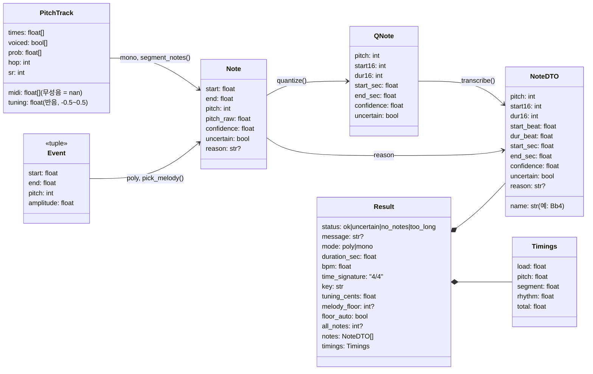
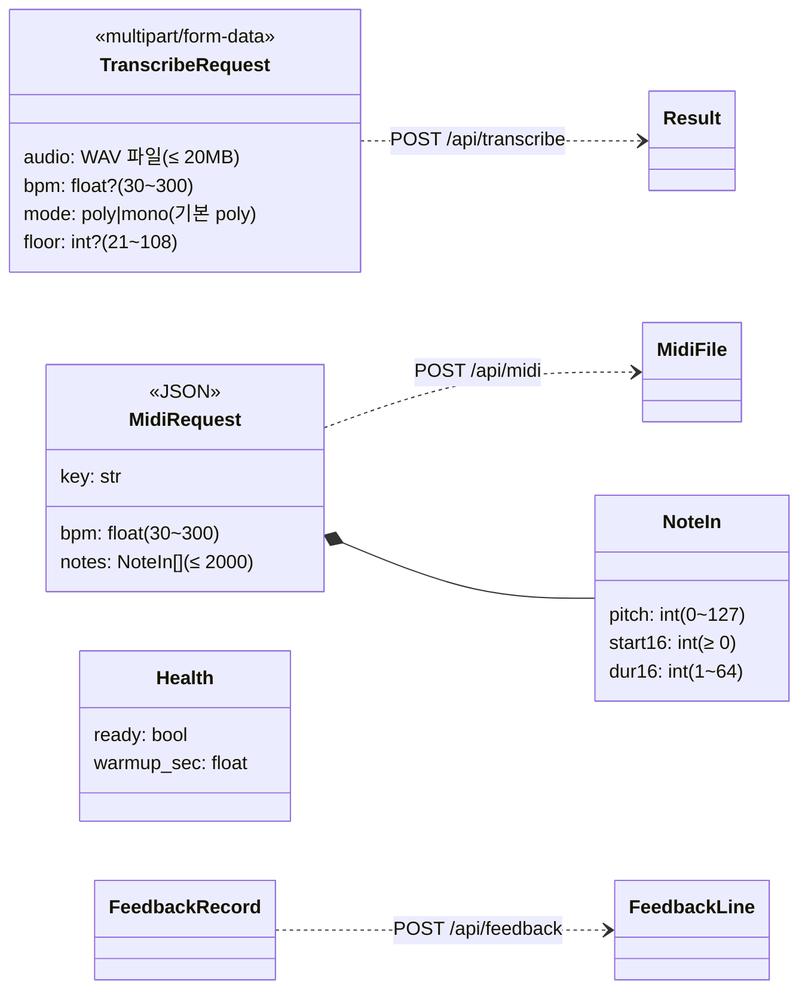
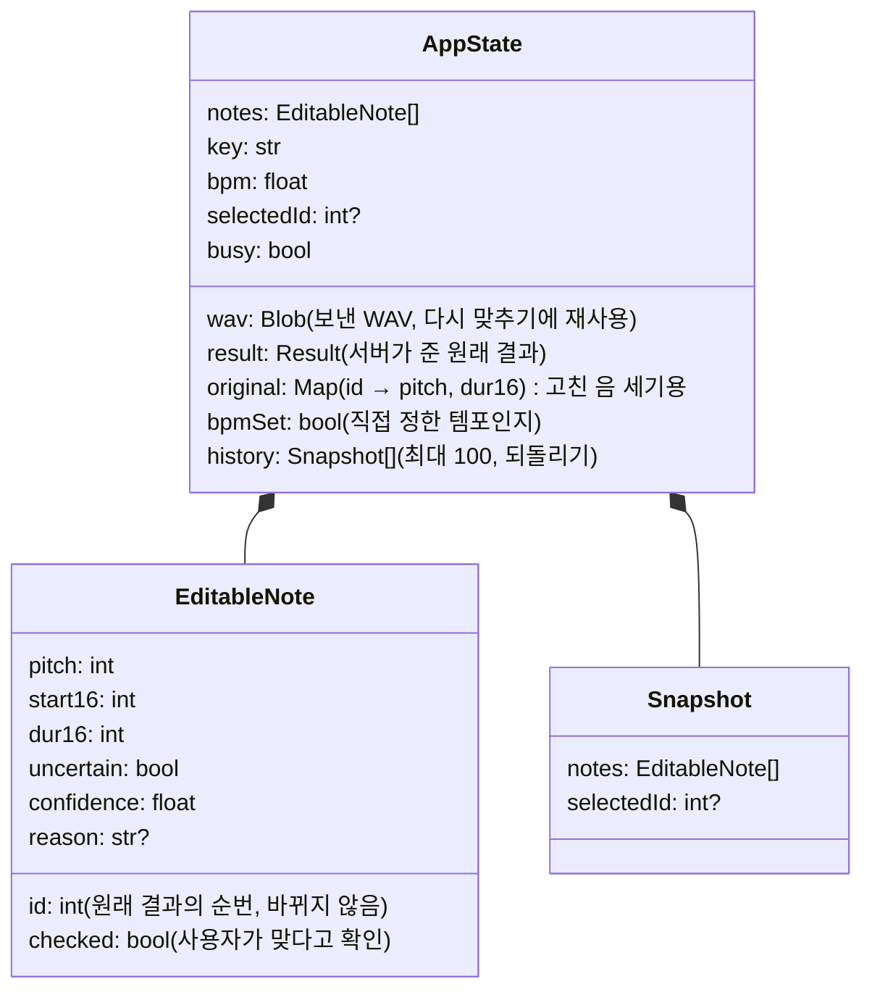

# 데이터 모델

데이터베이스는 없다. 데이터는 세 곳에 있다: **서버 메모리**(처리 중 객체, 캐시), **브라우저 메모리**(악보·고치기 상태), **로컬 파일**(`data/feedback.jsonl`).

## 1. 단위

| 값 | 단위 | 예 |
|---|---|---|
| 음높이 `pitch` | MIDI 번호 (60 = C4, 가온 도) | 67 = G4 |
| 시간 `start`, `end`, `*_sec` | 초 | 1.625 |
| 위치·길이 `start16`, `dur16` | 16분음표 칸 (4/4 한 마디 = 16칸) | `dur16 = 4` → 4분음표 |
| 허용 음가 | `1, 2, 3, 4, 6, 8, 12, 16` | 16분, 8분, 점8분, 4분, 점4분, 2분, 점2분, 온음표 |
| 템포 `bpm` | 4분음표 / 분 | 92.2 |
| 조 `key` | mido 조표 이름 | `C`, `Bb`, `F#m`, `Ebm` |
| 확신도 `confidence` | 0~1 | 0.82 |

## 2. 처리 단계별 모델 (서버, `pipeline/`)

`Result`의 `mode`, `melody_floor`, `floor_auto`, `all_notes`는이다.

### 불확실한 음의 이유 `reason`

| 값 | 방식 | 뜻 |
|---|---|---|
| `weak_voicing` | mono·poly | 소리가 약하거나 흐림 (mono: 유성음 확률 < 0.5, poly: 세기 < 0.3) |
| `between_pitches` | mono | 반올림한 음에서 0.35반음 넘게 벗어남 |
| `unstable_pitch` | mono | 음 안에서 음높이가 많이 흔들림 |
| `missing_fundamental` | mono | 1·2배음이 비어 있음 → 화음 의심 |
| `isolated_leap` | poly | 앞뒤 멜로디 음과 모두 한 옥타브 넘게 떨어짐 → 반주 음 의심 |

### 상태 `status`와 문구 (PRD 5장)

| status | 조건 | message |
|---|---|---|
| `ok` | 정상 | 없음 |
| `uncertain` | 불확실한 음 > 30% | mono: "멜로디 하나만 인식할 수 있어요…" / poly: "반주 음이 멜로디에 섞였을 수 있어요…" |
| `no_notes` | 음이 없음 | "음을 찾지 못했어요. 조용한 곳에서 다시 녹음해 주세요" |
| `too_long` | 61초 초과 | "1분 이내 녹음만 변환할 수 있어요" |

## 3. API 주고받는 모양

## 4. 브라우저 상태 (`web/static/app.js`의 `S`)

- **고친 음 수** = `original`의 음 중 지금 없거나(쉼표로 바꿈) 음높이·길이가 달라진 음의 수. 길이를 바꿔 뒤 음이 밀린 것은 세지 않는다.
- 새로고침하면 모두 사라진다 (저장하지 않음).

## 5. 피드백 기록 (`data/feedback.jsonl`, 한 줄 = 내보내기 한 번)

| 필드 | 내용 |
|---|---|
| `at` | 내보낸 시각 |
| `duration_sec`, `bpm`, `bpm_set`, `key` | 녹음 길이, 템포, 직접 정한 템포인지, 조 |
| `timings` | 서버 처리 시간 (단계별) |
| `original` | 서버가 준 원래 음 목록 (`NoteDTO[]`) |
| `edited` | 고친 뒤 음 목록 (`EditableNote[]`) |
| `edited_count`, `original_count`, `edited_ratio` | 고친 음 수, 원래 음 수, 비율 (PRD 목표 ≤ 0.2) |

이 컴퓨터에만 저장되고 Git에서 빠진다(`.gitignore`). 오즈의 마법사 테스트([wizard-of-oz.md](wizard-of-oz.md))에서 정답 곡과 함께 쓴다.

## 6. 서버 메모리

| 이름 | 내용 | 수명 |
|---|---|---|
| `state` | `ready`, `warmup_sec` | 서버가 켜져 있는 동안 |
| `EventCache` | 키: 업로드 파일 sha1 → 값: `Event[]` (다성 인식 결과), 최근 4개 | 서버가 켜져 있는 동안 |
| 임시 파일 | 업로드 원본, basic-pitch에 넘기는 WAV | 요청 하나가 끝나면 지움 |
