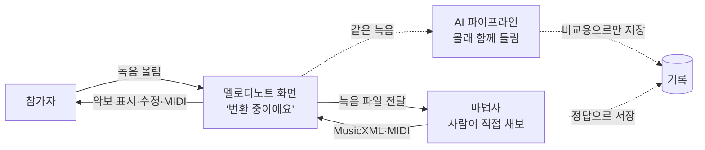

# 오즈의 마법사 테스트 계획

> 사용자는 AI가 변환한다고 생각하지만, 실제로는 사람(마법사)이 뒤에서 직접 채보해 돌려주는 테스트.
> AI 성능과 상관없이 "이 기능이 정말 필요한가, 결과를 어떤 모양으로 받고 싶은가"를 먼저 확인한다.

## 1. 왜 하나

PRD에는 근거가 "가정"인 항목이 많다. AI 정확도를 올리기 전에 아래를 사람 손으로 먼저 확인한다.

| 확인할 가정 (PRD 2·3·6장) | 테스트에서 보는 것 |
|---|---|
| 모티브를 녹음한 뒤 오선지로 옮기는 과정이 번거롭다 | 직접 채보할 때 걸리는 시간, 귀찮다고 느끼는 정도 |
| 결과는 멜로디 한 줄이면 된다 | 참가자가 원하는 결과: 멜로디만 / 양손 전체 / 코드 이름까지 |
| 수십 초 기다리는 건 괜찮다 | 기다림을 몇 초까지 받아들이는지 |
| 고치는 음이 20% 이하면 쓸 만하다 | 결과를 받고 몇 음을 고치는지, 고친 뒤 실제로 쓰는지 |
| 직접 채보보다 시간이 절반 이하로 든다 | 받은 결과를 고쳐 쓰는 시간 vs 처음부터 채보하는 시간 |

> 2026-11-27에 이미 하나가 뒤집혔다: 사용자는 모티브를 주로 **피아노 양손**으로 녹음한다. 이 테스트는 "그래서 결과로 무엇을 원하나"를 확인하는 데 무게를 둔다.

## 2. 구성

- **화면**: 지금 만든 웹 화면을 그대로 쓴다. 서버의 `/api/transcribe`만 "마법사 모드"로 바꿔, 녹음을 받아 두고 마법사가 올린 결과를 돌려준다.
- **마법사**: 채보할 수 있는 사람 1명(프로젝트 주인 또는 지인). MuseScore로 듣고 적은 뒤 MIDI로 올린다.
- **AI 몰래 돌리기**: 같은 녹음을 AI로도 변환해 기록만 해 둔다. 참가자에게는 보이지 않는다.

## 3. 참가자와 녹음

- 참가자 3~5명: 작곡가·연주자 (모티브를 녹음해 두는 습관이 있는 사람)
- 1인당 녹음 3개, 각 1분 이내
  - 평소 방식대로 1개 (피아노 양손이든 허밍이든)
  - 허밍·노래 1개
  - 피아노 양손 1개
- 모두 15개 안팎 → 2단계 정확도 측정에 필요한 "정답 곡 10개"를 넉넉히 채운다

## 4. 진행 순서 (1인당 약 30분)

| 순서 | 할 일 | 재는 것 |
|---|---|---|
| 1 | 평소처럼 모티브를 녹음한다 | 녹음 길이, 녹음 방식 |
| 2 | 같은 녹음을 직접 오선지나 DAW에 옮긴다 (기준 시간) | 직접 채보 시간 |
| 3 | 다른 녹음을 화면에 올리고 기다린다 | 마법사가 돌려줄 때까지 걸린 시간, 기다리며 한 말 |
| 4 | 결과를 보고 틀린 음을 고친 뒤 MIDI로 내보낸다 | 고친 음 수 / 전체 음 수, 고치는 데 든 시간 |
| 5 | 짧은 인터뷰 | 아래 질문 |
| 6 | 사람이 채보했다는 사실을 밝히고 동의를 다시 받는다 | 녹음·기록을 계속 써도 되는지 |

마법사가 돌려주는 시간은 두 가지로 나눠 본다: **30초 안** / **3분 뒤**. 기다림을 어디까지 받아들이는지 보려는 것이다.

### 인터뷰 질문

1. 결과를 받고 가장 먼저 한 일은 무엇인가요?
2. 멜로디만 받는 것과 양손 전체를 받는 것 중 무엇이 더 쓸모 있나요? 왜요?
3. 몇 초까지 기다릴 수 있나요?
4. 이 결과를 다음에 어디에 쓰겠어요? (DAW로, 악보 공유, 레슨 …)
5. 직접 채보할 때보다 편했나요? 다음에도 쓰겠어요?

## 5. 성공 기준 (PRD 6장과 연결)

| 기준 | 통과 | 다시 생각 |
|---|---|---|
| 고친 음 비율 | 20% 이하 | 20% 넘으면 결과 모양(멜로디/양손)부터 다시 본다 |
| 시간 | 받은 결과를 고쳐 쓰는 시간이 직접 채보의 절반 이하 | 비슷하거나 더 길면 고치기 화면을 다시 설계 |
| 다시 쓸 의향 | 5명 중 3명 이상 "다음에도 쓰겠다" | 2명 이하면 문제 정의를 다시 본다 |
| 원하는 결과 모양 | 과반이 고른 쪽을 첫 버전 출력으로 | 반반이면 두 가지를 모두 고를 수 있게 |

## 6. 기록하는 것

- 녹음 파일, 마법사 결과(MIDI), 몰래 돌린 AI 결과, 참가자가 고친 최종 MIDI
- 지금 서버의 `data/feedback.jsonl`(원래 결과·고친 결과·고친 음 비율)을 그대로 쓴다
- **마법사 결과 = 2단계 정확도 측정의 정답 곡**. AI 결과와 비교하면 PRD의 "음높이 90%, 음가 한 단계 이내"를 실제 녹음으로 잴 수 있다

## 7. 주의할 점

- 녹음은 참가자의 창작물이다. 테스트 전에 녹음 보관·사용 범위를 알리고 동의를 받는다. 끝나고 사람이 채보했다는 사실을 밝힌다.
- 마법사가 너무 잘하면 기대치가 올라간다. 마법사는 "고칠 게 조금 남은" 수준으로 맞추지 않고 정직하게 채보하되, AI 결과와의 차이를 따로 기록한다.
- 마법사 한 명이 15개를 채보하는 시간(개당 10~20분)을 미리 잡아 둔다.
